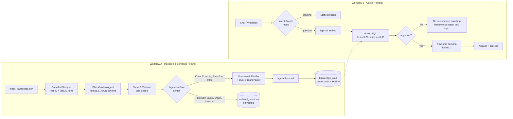

# Bounded Dual-Stream RAG & Ingestion Firewall in n8n

A local RAG pipeline for GenX Leadership Academy built with **n8n**, **PostgreSQL 16 + pgvector** and **Ollama** (`bge-m3` embeddings, `llama3.2` generation). Everything runs on your machine.

- **Workflow A: Ingestion & Semantic Firewall.** An LLM classifies each meeting transcript from a bounded sample. Only *Client Coaching* calls with confidence ≥ 0.80 reach the vector store. Each approved call is split into two streams: a dense **framework** note and verbatim **voice samples** from the coach. Internal and sales calls are archived in a flat table with no embeddings.
- **Workflow B: Gated Retrieval & Persona Synthesis.** Greetings are answered statically. Questions run a raw SQL cosine search with a hard cutoff per stream. If nothing clears the cutoff, a circuit breaker returns a fixed fallback and the LLM is never called. Otherwise a positive few-shot prompt answers in Dr. Sara Hegy's voice and cites its sources.



## Repository layout

```
├── docker-compose.yml          # 1-command startup: pgvector + n8n (+ auto-import of workflows & credential)
├── init.sql                    # pgvector extension, knowledge_vault, HNSW cosine index, archived_sessions
├── workflows/
│   ├── ingestion_firewall.json # Workflow A (n8n export)
│   └── gated_retrieval.json    # Workflow B (n8n export)
├── data/
│   └── mock_transcripts.json   # the 4 sample sessions
├── src/                        # Code-node JavaScript + SQL as plain files (embedded into the workflow JSONs)
│   ├── ingestion/*.js
│   └── retrieval/*.js, gated_search.sql
├── scripts/
│   ├── build_workflows.py      # regenerates workflows/*.json from src/
│   ├── verify.sh               # end-to-end check -> verification log
│   └── verify.sql              # DB checks used by verify.sh
├── tests/code_nodes.test.js    # unit tests for every Code node (no n8n needed)
├── docs/verification_log_sandbox.txt
└── README.md
```

## Quickstart

**Prerequisites:** Docker Desktop (or Docker Engine + Compose v2), and [Ollama](https://ollama.com) **0.5 or newer**, which is needed for JSON-schema structured outputs.

```bash
# 1. Models (one-time, ~3.2 GB)
ollama pull bge-m3
ollama pull llama3.2

# 2. Clone and start
git clone https://github.com/deryaauysl/genx-dual-stream-rag.git
cd genx-dual-stream-rag
docker compose up -d          # postgres -> n8n-import (one-shot) -> n8n
```

3. Open **http://localhost:5678** and create the local owner account (n8n asks for one on first launch).
   Both workflows and the `GenX pgvector` Postgres credential are already imported and published. You don't need to do anything else.
4. **Run Workflow A:** open *A - Ingestion & Semantic Firewall* and click **Execute workflow**, or run:
   ```bash
   curl -X POST http://localhost:5678/webhook/ingest
   ```
5. **Chat with Workflow B:** open *B - Gated Retrieval & Persona Synthesis* and click **Open chat**, or run:
   ```bash
   curl -s -X POST http://localhost:5678/webhook/coach-chat \
        -H 'Content-Type: application/json' \
        -d '{"message":"How should I approach an underperforming VP?"}'
   ```
6. **Verify everything in one go** (runs ingestion, the DB checks and four test questions):
   ```bash
   ./scripts/verify.sh | tee docs/verification_log.txt
   ```

**Reaching Ollama from Docker**
- *macOS / Windows (Docker Desktop):* works out of the box via `host.docker.internal`.
- *Linux:* Ollama listens only on `127.0.0.1` by default. Start it with `OLLAMA_HOST=0.0.0.0 ollama serve` (or set that in the systemd unit) so the n8n container can reach it.
- *Or run Ollama inside compose:* `docker compose --profile ollama up -d`, put `OLLAMA_BASE_URL=http://ollama:11434` in `.env`, then `docker exec genx-ollama ollama pull bge-m3 && docker exec genx-ollama ollama pull llama3.2`.

Every setting has a default. `.env.example` lists what you can override: ports, credentials, model names and the n8n version.

**Reset everything:** `docker compose down -v && docker compose up -d`

## Architecture notes

### Part 1: Infrastructure
- `pgvector/pgvector:pg16`. `init.sql` is mounted into `docker-entrypoint-initdb.d`, so it runs automatically on the first start.
- `knowledge_vault(id, session_id, stream_type, chunk_index, content, metadata JSONB, embedding vector(1024))`. `stream_type` is CHECK-constrained to `framework | voice_sample`. A UNIQUE constraint on `(session_id, stream_type, chunk_index)` makes ingestion an idempotent **upsert**.
- HNSW index: `USING hnsw (embedding vector_cosine_ops) WITH (m=16, ef_construction=64)`. It matches the `<=>` cosine operator used at query time; `scripts/verify.sql` shows the planner using it.
- `archived_sessions` has **no vector column**, so a rejected call can't be retrieved even by mistake.
- The `n8n-import` one-shot service generates the Postgres credential from the same env vars as the database, imports both workflows and publishes them, so `docker compose up` needs no clicking around.

### Part 2: Workflow A (ingestion & semantic firewall)

| Node | What it does |
|---|---|
| **Read Transcripts File → Parse JSON File** | Reads `/data/mock_transcripts.json` (mounted read-only; n8n file access is restricted to `/data`). |
| **Bounded Sampler** (Code) | Unwraps the `[{ json: { data: [...] } }]` envelope into one item per session. Builds the sample from the **first 40 + last 20 turns**; transcripts of ≤ 60 turns are used whole with no duplicated turns, and longer ones get an explicit `[N middle turns omitted]` marker. Builds the classifier request. |
| **Classification Agent** (HTTP → Ollama `/api/chat`) | `llama3.2`, `temperature 0`, Ollama **structured output** using a JSON schema with an `enum` for `meeting_type`. Retries once; *On Error → Continue*, so an outage can't crash the run. |
| **Parse & Validate Classification** (Code) | Defensive parsing: strips ```` ```json ```` fences and surrounding text, maps near-miss labels onto the four allowed values, and normalises `0.92`, `"92%"` and `92` to `0.92`, clamped to [0, 1]. Anything unparseable becomes `Other / 0`, which **fails closed**, so the session is archived rather than ingested. |
| **Ingestion Gate** (Switch) | Output 0: `meeting_type == "Client Coaching"` **AND** `confidence_score >= 0.80` → ingest. Outputs 1–3 (Internal Operations, Sales Discovery, fallback for Other or low confidence) → archive. |
| **Prepare Archive Row → Archive Rejected Session** (Postgres) | Writes a flat row with a reject reason, using parameterised SQL. It also purges any vectors left by an earlier run, so a session reclassified as noise disappears from retrieval. |
| **Framework Distiller (LLM)** | Turns the full transcript into a dense note with a fixed layout: `Framework / Use when / Core idea / How to apply / Key question`. The "Use when" line is written in the words a leader would use when asking, which makes the note easy to match against real questions. |
| **Dual-Stream Parser** (Code) | Produces both streams. **Stream 1 (framework):** the distilled note, with an *extractive fallback* built from the coach's own teaching turns if the LLM output is empty or malformed. **Stream 2 (voice_sample):** speaker filtering keeps only the coach's turns (the GenX team member who speaks most). Turns are split into sentences, protecting "Dr." and "e.g.", and an optimal-partition DP packs whole sentences into **400–700 character** chunks with a blank line between turns, to keep her speaking rhythm. If the coach's text doesn't divide cleanly, neighbouring sentences are borrowed as overlap. |
| **Embed Chunk (bge-m3) → Prepare Vector Row → Upsert** | Checks every embedding (exactly 1024 finite numbers) before writing. A bad embedding stops the run with a clear message instead of corrupting the vault. |

Result on the mock data: SES-101 and SES-102 each produce 1 framework chunk and 2 voice chunks (409–455 characters). SES-103 and SES-104 are archived.

### Part 3: Workflow B (gated retrieval & persona)
- **Intent Router** (Code, regex): `^(hi|hello|hey|good morning|…)(dr. sara|there|team)?[!.,]*$` matches *pure* greetings only. "Hi, how do I delegate?" is treated as a question. Greetings take the **Static Greeting** branch: no embedding, no SQL, no LLM.
- **Gated Vector Search** (raw SQL, `src/retrieval/gated_search.sql`): two CTEs, each with its own hard cutoff and `LIMIT 2`, combined with `UNION ALL`:
  ```sql
  WHERE stream_type = 'framework'    AND 1 - (embedding <=> $1::vector(1024)) >= 0.70 ORDER BY embedding <=> $1 LIMIT 2
  WHERE stream_type = 'voice_sample' AND 1 - (embedding <=> $1::vector(1024)) >= 0.65 ORDER BY embedding <=> $1 LIMIT 2
  ```
  Separate CTEs mean a strong framework match can't crowd voice samples out of a shared LIMIT, and the reverse.
- **Zero-Match Circuit Breaker:** the Postgres node has *Always Output Data* on, so zero rows still produce one empty item instead of silently ending the run. The Code node counts real rows, and the IF node sends `match_count = 0` to **Fallback Response**: `"No documented coaching frameworks match this topic."`. The LLM node is on the other branch, so on a miss it **cannot** run.
- **Persona Synthesis:** the system prompt only says what Dr. Sara *does*: reframe, name the framework, two to four moves, a diagnostic question, a next step, 120–200 words. Two worked **few-shot** examples (user → assistant turns using clearly illustrative frameworks) show the target cadence, and the real `CONTEXT` (frameworks) and `VOICE SAMPLES` are injected last in the same format, so the model continues the pattern. **Format Answer** appends exact citations (`SES-102 framework #0 (sim 0.78) | …`) in code, so sources are never made up by the LLM.

### Testing
- `node tests/code_nodes.test.js` unit-tests every Code node with mocked `$input` and `$()` (sampling, malformed classifier JSON, chunk bounds, greeting regex, circuit breaker). It also checks that the workflow JSONs embed exactly the tested source.
- The full stack was run end to end on n8n 2.47.7 with PostgreSQL 16 + pgvector; see `docs/verification_log_sandbox.txt`. In that build sandbox Ollama's model downloads were blocked, so a stand-in HTTP server replaced Ollama. That log proves routing, gating, storage and the circuit breaker; the real-model log is below.

## Verification log

> Produced with `./scripts/verify.sh` against real `bge-m3` + `llama3.2`. The full output is in `docs/verification_log.txt`.

<!-- VERIFICATION_LOG_START -->
_Run `./scripts/verify.sh | tee docs/verification_log.txt` and paste the key parts here._
<!-- VERIFICATION_LOG_END -->

**Expected results:**

| Check | Expected |
|---|---|
| SES-101, SES-102 | in `knowledge_vault`, one `framework` + several `voice_sample` rows each, `dims = 1024` |
| SES-103, SES-104 | in `archived_sessions` as `Internal Operations` / `Sales Discovery`; firewall check query returns 0 rows |
| "Hi" | `route: greeting`, no model calls |
| "How should I approach an underperforming VP?" | `route: persona_answer`, sources include **SES-102**, answer in Dr. Sara's voice (Table and Shoulder Test) |
| "How do I fix my database index?" | `route: circuit_breaker`, output `No documented coaching frameworks match this topic.`, `llm_called: false` |

**Tuning note:** 0.70 / 0.65 are the thresholds from the brief. Similarity scales differ between embedding models. If a clearly on-topic question hits the fallback with your setup, lower the framework cutoff in `gated_search.sql` slightly and re-check that the off-domain question still trips the breaker. The `similarity` values in the webhook response make this easy to calibrate.

## Architectural reflection

**Q1. Why does threshold gating in SQL work better than asking the LLM to say "I don't know"?**

1. **It's deterministic, not a request.** `similarity >= 0.70` is a hard rule enforced by the database. "Say I don't know if the context is irrelevant" is a request the model may or may not follow. Instruction-tuned models are trained to be helpful, and small local models like a 3B `llama3.2` often ignore abstention instructions.
2. **Plain top-k always returns something.** Without a cutoff, `ORDER BY distance LIMIT 4` returns the four *least bad* chunks even for "how do I fix my database index?". Once text sits in the prompt labelled as context, the model treats it as relevant and stitches a confident, wrong answer from it. That's exactly the hallucination the gate prevents. The best defence is never putting irrelevant text in the prompt.
3. **It's cheaper and faster.** A miss costs one embedding and one indexed query. The LLM call, the slowest and most expensive step, is skipped entirely.
4. **It's measurable and tunable.** The threshold is a number you can calibrate with labelled questions, log (`similarity` is in every response) and regression-test. Prompt-based abstention can only be tested indirectly and changes whenever you change the model or the wording.
5. **Separation of concerns.** Retrieval decides *whether* there's grounded knowledge; the LLM only decides *how to say it*. The fallback text is fixed and predictable, which matters for a client-facing coaching product.

**Q2. What are the trade-offs of a higher vs lower HNSW `ef_search` at query time?**

`hnsw.ef_search` (pgvector default 40) is the size of the candidate list kept while walking the HNSW graph. It's the main recall-versus-speed setting at query time and can be changed per query (`SET LOCAL hnsw.ef_search = 100`) without rebuilding the index.

- **Higher `ef_search`:** explores more of the graph, giving recall closer to an exact search with fewer missed true neighbours. The cost is more distance calculations, so higher latency and CPU per query, which matters at high traffic or on large tables.
- **Lower `ef_search`:** faster and cheaper, but approximate. It can miss the real best match and return a slightly worse one.
- **Why it matters more in this design:** pgvector applies `WHERE` filters (here `stream_type = …` and the similarity cutoff) *after* the index produces its candidates, and an HNSW scan can return at most `ef_search` rows. If `ef_search` is low and many candidates are the other stream type or fall below the cutoff, the query can return fewer than `LIMIT 2` rows, or **zero**, even though qualifying chunks exist. In this pipeline that falsely trips the circuit breaker ("No documented coaching frameworks…") for a question we could have answered. Keep `ef_search` well above the LIMIT, raise it as the vault grows, or use pgvector ≥ 0.8 `hnsw.iterative_scan`. Alternatively, use a partial index per `stream_type`.
- At this dataset's size (6 rows), any `ef_search` effectively gives an exact search. The trade-off only appears with thousands of chunks or more.
